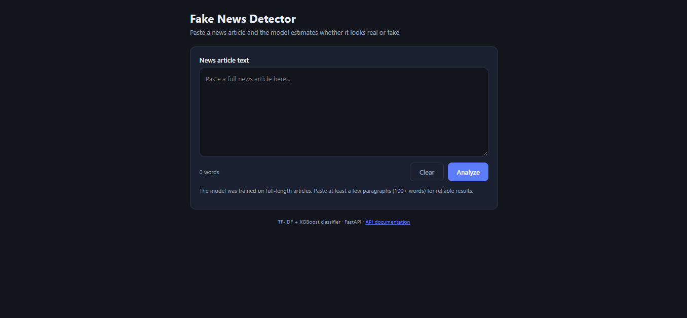

# Fake News Detection API

A machine learning model that classifies news text as **Real** or **Fake**, served through a FastAPI prediction endpoint.

Developed as part of a Big Data Analytics course: TF-IDF text features, an XGBoost classifier, and the final model exposed as an API.

## Overview

| | |
|---|---|
| **Task** | Binary text classification (Real vs Fake news) |
| **Features** | TF-IDF vectorization (about 212,000-term vocabulary) |
| **Model** | XGBoost classifier |
| **Serving** | FastAPI + Uvicorn |
| **Interface** | Web page served by the API (HTML/CSS/JavaScript) |
| **Packaging** | Docker, GitHub Actions |

## How It Works

1. Incoming text is converted into a TF-IDF vector using the saved, fitted vectorizer (`tfidf_vectorizer.pkl`).
2. The saved **XGBoost** classifier (`best_fake_news_model.pkl`) predicts whether the text is real or fake.
3. The API returns the label, plus a confidence score when the model supports probability estimates.
4. A simple web page (served at the home URL) lets anyone paste an article and see the result with a confidence bar.

## API

### `POST /predict`

Request:

```json
{ "text": "Paste the news article text here" }
```

Response:

```json
{ "prediction": "Fake News", "confidence": 0.93 }
```

`prediction` is `"Real News"` or `"Fake News"`. `confidence` is included when the saved model supports `predict_proba`. Empty text returns a `400` error.

### `GET /`

Serves the web interface.

### `GET /health` (also `/media`)

Health check. Returns `{"status": "API is running successfully."}`.

Interactive docs are available at http://localhost:8000/docs once the server is running.

## Screenshots

| Web interface|
|---|
|  |

## Run Locally

```bash
git clone https://github.com/fizaf0012/fake-news-api.git
cd fake-news-api
pip install -r requirements.txt
uvicorn main:app --reload
```

Then open http://localhost:8000 for the web interface, or http://localhost:8000/docs for the interactive API docs.

> The saved vectorizer was created with scikit-learn 1.6.1, so `requirements.txt` pins that version. Using a different version can give a warning or incorrect results. Run `python inspect_model.py` to see what is inside the saved files.

### With Docker

```bash
docker build -t fake-news-api .
docker run -p 8000:8000 fake-news-api
```

## Project Structure

```
fake-news-api/
├── main.py                      # FastAPI app
├── inspect_model.py             # prints model and vectorizer details
├── static/
│   └── index.html               # web interface
├── best_fake_news_model.pkl     # trained classifier
├── tfidf_vectorizer.pkl         # fitted TF-IDF vectorizer
├── requirements.txt
├── Dockerfile
├── .github/workflows/           # CI workflow
└── screenshots/                 # web UI and API screenshots
```

## Limitations

- Public fake news datasets often score very high because articles from the two classes differ in source-specific patterns (datelines, outlet names, formatting). Performance on news from other sources may be lower.
- The model classifies writing style and vocabulary. It does not check facts.
- It was trained on full-length articles, so very short text (one sentence) gives unreliable predictions. Paste a full paragraph or article when testing.

## Tech Stack

Python · scikit-learn · XGBoost · TF-IDF · FastAPI · Uvicorn · HTML/CSS/JavaScript · Docker · GitHub Actions

<!--
OPTIONAL SECTIONS: add these only with numbers you can verify from your notebook or report.

## Dataset
- Source: <dataset name and link>
- Size: <number of articles> (<real count> real, <fake count> fake)
- Split: <e.g. 80/20 train/test>

## Results (held-out test set)
| Model | Accuracy | Precision | Recall | F1 |
|---|---|---|---|---|
| Logistic Regression | | | | |
| Random Forest | | | | |
-->

## Author

**Fiza Fatima** · [GitHub](https://github.com/fizaf0012) · [LinkedIn](https://www.linkedin.com/in/fiza-fatima-aa2b9a272/)
